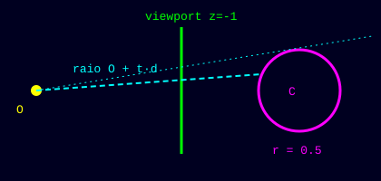

Seu primeiro ray tracer! Gere uma imagem **PPM P3** de uma esfera colorida pelas normais sobre um céu em gradiente. Clique em **Executar** com a entrada `256 128` e veja a imagem aparecer no painel de saída.



## Cena

- câmera na origem $O = (0, 0, 0)$, olhando para $-z$
- viewport com altura $v_h = 2$ e largura $v_w = 2 \cdot W / H$, a distância focal $1$ (no plano $z = -1$)
- esfera com centro $C = (0, 0, -1)$ e raio $r = 0.5$

Para o pixel na coluna $i$ e linha $j$ (linha 0 no topo), o raio é $O + t\,\vec d$ com

$$
\vec d = \left(-\frac{v_w}{2} + \frac{(i + 0.5)\,v_w}{W},\ \frac{v_h}{2} - \frac{(j + 0.5)\,v_h}{H},\ -1\right)
$$

## Interseção raio-esfera

Substituindo o raio na equação da esfera $\lVert P - C \rVert^2 = r^2$:

$$
a = \vec d \cdot \vec d,\quad h = \vec d \cdot (C - O),\quad c = \lVert C - O \rVert^2 - r^2,\quad \Delta = h^2 - a c
$$

Se $\Delta \ge 0$ e $t = \dfrac{h - \sqrt{\Delta}}{a} > 0$, o raio acerta a esfera no ponto $P = O + t\,\vec d$.

## Cor

- **Acertou:** normal $\hat n = (P - C) / r$, cor $= 0.5\,(\hat n + 1)$.
- **Errou (céu):** com $\hat d = \vec d / \lVert \vec d \rVert$ e $\alpha = 0.5\,(\hat d_y + 1)$, cor $= (1 - \alpha)\,(1, 1, 1) + \alpha\,(0.5, 0.7, 1.0)$.

Cada canal vira inteiro com $\lfloor 255.999 \cdot c \rfloor$.

## Entrada

Uma linha com `W H` (largura e altura, $1 \le W, H \le 512$).

## Saída

Imagem PPM P3: cabeçalho `P3`, `W H`, `255`, e depois um pixel `r g b` por linha, da esquerda para a direita, de cima para baixo.

```
P3
4 2
255
...
```

O corretor compara pixel a pixel com tolerância de ±2 por canal (diferenças de ponto flutuante entre compiladores são normais).
